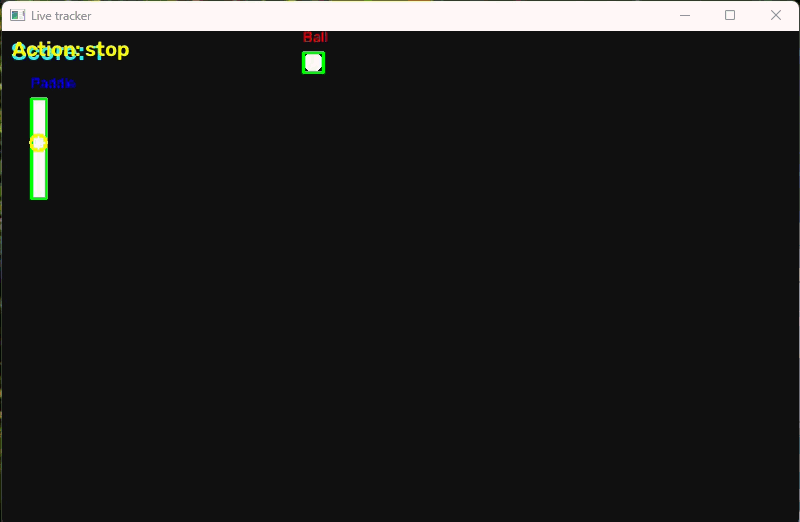

# pong-tracker
This is my first project.
Objective:
Create a python program that 1. detects a ball and a paddle in a pong game, 2. plays the game accordingly.
I created pong.py only to have a simple pong game to use my program on, but the tracker is independent from pong.py and does not know any information used in the game script.

## Demo

## requirements
See req.txt
Needs python 3.13

## files
- pong.py - simple pong game made with pygame,
- pong-increasing.py - increases velocity at every bounce, to test how accurate the tracker is with increasing speed.
- tracker_1.0.py - paddle moves up and down following the ball's vertical velocity.
- tracker_1.1.py - to be deleted, experimental.
- tracker_2.0.py - predicts where the ball will reach the paddle, accounting for wall reflections.
- tracker_2.1.py - accounts for the ball's radius and uses more widely spaced position samples to reduce prediction fluctuations.

## how the prediction works (versions 2.1)
The tracker estimates the slope sampling the position of the balls at 2 instances dt=0.6s apart. It then finds the y intercept (with x=lef_paddle_bound) and finally mirrors it to account for top and bottom bounces.

## DEVELOPMENT HISTORY
### Version 1.0
The paddle follows the ball's vertical direction. It does not predict where the ball will arrive. Fails when the vertical oscillation is quick but is effective otherwise.

### Version 2.0
Introduces trajectory prediction.
However, the positions used to estimate the trajectory are sampled too close together in time.
Small detection errors cause large changes in the estimated slope, making the target position fluctuate.
This version also ignores the ball's radius.

### Version 2.1
Accounts for the ball's radius and estimates direction using positions sampled at least 0.6 seconds apart.
This reduces fluctuations, but introduces another limitation: a bounce may occur between the two samples. In that case, the estimated slope does not represent the ball's current direction.

## Current limitations and next steps
- Handle velocity estimation then a bounce occurs between samples.
- Experiment with predicting the interception point only once per rally.
- Test prediction accuracy as the ball's speed increases.
